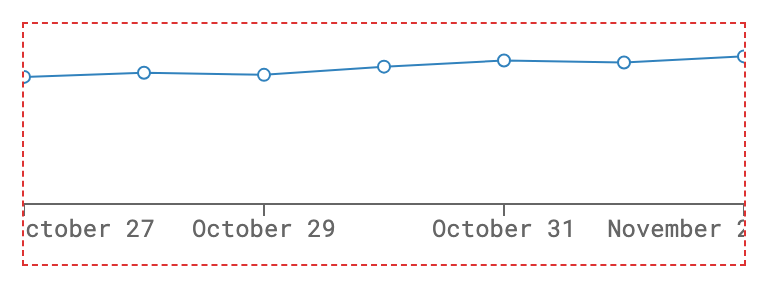
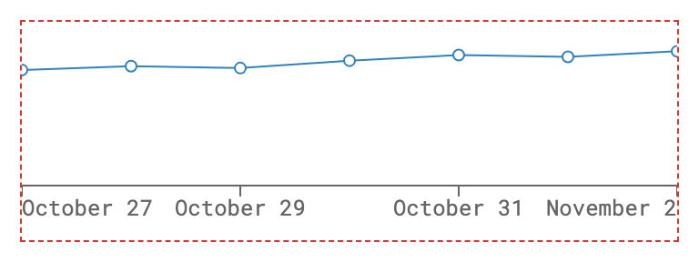

# Recharts measures axis tick labels in the page's font, not the tick's

When an axis's ticks use a different font family than the page (for example `tick={{ fontFamily: "Roboto Mono" }}` on a page set in Roboto), Recharts measures every tick label in the page's font. The labels come out narrower than they render, so the clamp that keeps the first and last labels inside the axis falls short, and both edge labels run past the SVG and get clipped. The overflow is exactly half the difference between the measured and rendered widths.

## Reproduction

```sh
npm install
npm run repro
```

`npm run repro` installs Playwright's Chromium, serves `index.html` with Vite and loads it three times. Each load renders the same `LineChart` (360px wide, `margin.right` and `margin.left` 0) whose `XAxis` has `interval="preserveStartEnd"` and `tick={{ fontFamily: "Roboto Mono", fontSize: 12 }}`. Only the page CSS changes:

- `bug`: the page font is Roboto.
- `body-matches-tick`: the page font is Roboto Mono, the same as the ticks.
- `span-matches-tick`: the page font stays Roboto, and a CSS rule gives `#recharts_measurement_span` the Roboto Mono font.

For each load it prints the first and last labels' widths as measured in `#recharts_measurement_span` (the same span and inline style Recharts measured them with) and as rendered, and where each label ends against the SVG. It saves a screenshot of each chart to `screenshots/` and exits with code 1 when a label runs past the SVG. Both fonts are web fonts loaded before the chart renders, so the numbers are the same on any OS.

Output:

```
recharts 3.10.1, chromium 158.0.8127.18

bug: page font Roboto, tick font Roboto Mono
  measurement span font: Roboto, sans-serif
  tick font:             "Roboto Mono"
  shown labels:          October 27, October 29, October 31, November 2
  first label "October 27": measured 58.8px wide, rendered 72.0px wide, 6.6px past the SVG's left edge (clipped)
  last label "November 2": measured 64.8px wide, rendered 72.0px wide, 3.6px past the SVG's right edge (clipped)
  FAIL

body-matches-tick: page font Roboto Mono, tick font Roboto Mono
  measurement span font: "Roboto Mono", monospace
  tick font:             "Roboto Mono"
  shown labels:          October 27, October 29, October 31, November 2
  first label "October 27": measured 72.0px wide, rendered 72.0px wide, inside the SVG's left edge
  last label "November 2": measured 72.0px wide, rendered 72.0px wide, inside the SVG's right edge
  OK

span-matches-tick: page font Roboto, tick font Roboto Mono, #recharts_measurement_span set to Roboto Mono
  measurement span font: "Roboto Mono", monospace
  tick font:             "Roboto Mono"
  shown labels:          October 27, October 29, October 31, November 2
  first label "October 27": measured 72.0px wide, rendered 72.0px wide, inside the SVG's left edge
  last label "November 2": measured 72.0px wide, rendered 72.0px wide, inside the SVG's right edge
  OK

Tick labels run past the SVG in: bug
```

The dashed line is the SVG's edge.

`bug`: "October 27" loses its "O" and "November 2" loses half of its "2".



`body-matches-tick` (`span-matches-tick` looks the same):



To look at it in a browser, run `npm run dev` and open `/?variant=bug`, `/?variant=body-matches-tick` or `/?variant=span-matches-tick`.

To try the canary: `npm install recharts@3.11.0-canary.9 && npm run repro` prints the same numbers.

## Expected

The axis measures each label in the font it renders with, so the first and last labels are clamped inside the axis (as in `body-matches-tick`), whatever the page font is.

## Actual

The axis reads only the tick's font size and letter spacing, and measures the labels in a span whose font family and weight come from `<body>`:

- `src/cartesian/CartesianAxis.tsx`: the `layerRef` callback reads `computedStyle.fontSize` and `computedStyle.letterSpacing` from the first `.recharts-cartesian-axis-tick-value` and drops the rest of the tick's font.
- `src/cartesian/getTicks.ts`: `getTicks` passes only `{ fontSize, letterSpacing }` to `getStringSize`.
- `src/util/DOMUtils.ts`: `measureTextWithDOM` measures in `#recharts_measurement_span`, appended to `document.body`, so its font family, weight and style are inherited from the body.
- `src/cartesian/getTicks.ts`: `getTicksStart` and `getTicksEnd` shift the edge labels (`tickCoord`) by half the measured width, so a label measured `d` px too narrow ends `d / 2` px past the axis. `isVisible`, which drops labels closer than `minTickGap`, uses the same widths.

## Environment

- recharts 3.10.1 and 3.11.0-canary.9
- react and react-dom 19.3.1
- Chromium 158 (also fails in Firefox 159 and WebKit 27.2), through Playwright 1.65.0
- Node 24.22.0, npm 11.19.1, macOS 27.2
